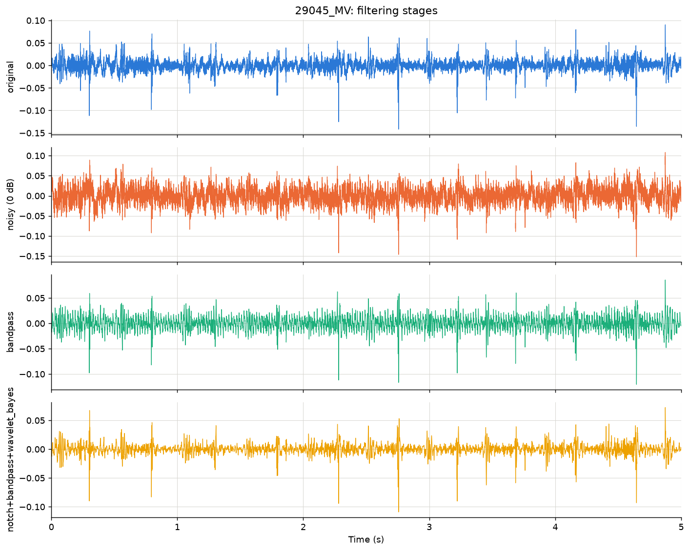
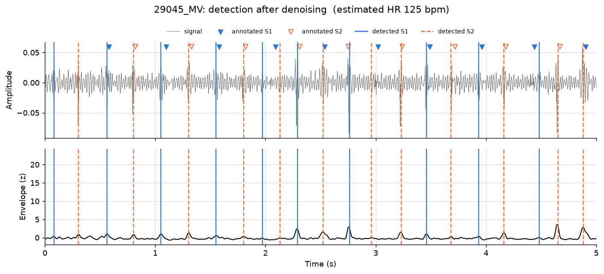

# CardioFilter

**A low-cost digital stethoscope prototype and a Python signal-processing pipeline
that cleans up recorded heart sounds and finds S1 and S2.**

Traditional stethoscope recordings pick up mains hum, handling rumble, room noise and
sensor hiss, which hide the two short sounds (S1, S2) that mark each cardiac cycle.
CardioFilter asks a practical question: with a ~US$26 probe, how much of that can
software recover, and which filter should run first? It compares a Butterworth
bandpass against wavelet thresholding on the
[CirCor DigiScope](https://physionet.org/content/circor-heart-sound/1.0.3/)
paediatric dataset (5 272 recordings, 1 568 subjects) under controlled noise.

| | |
|---|---|
|  |  |
| *Original → noisy (hum + hiss + rumble at 0 dB) → bandpass → bandpass + wavelet* | *S1 (blue) and S2 (orange) detected after denoising; triangles are the expert annotations* |

## What is in the box

| Part | Where |
|---|---|
| Butterworth bandpass (25–400 Hz, zero-phase) | `cardiofilter/filters/bandpass.py` |
| Wavelet denoising (`coif4`, universal or BayesShrink thresholds) | `cardiofilter/filters/wavelet.py` |
| Mains-hum notch cascade with automatic 50/60 Hz detection | `cardiofilter/filters/notch.py` |
| Noise models: white, pink, mains hum, rumble, ambient, mixed at a target SNR | `cardiofilter/noise.py` |
| Shannon-energy and homomorphic envelopes | `cardiofilter/envelope.py` |
| S1/S2 detector (period estimate → peak picking → interval labelling) | `cardiofilter/detection.py` |
| SNR, PRD, correlation and tolerance-window detection scoring | `cardiofilter/metrics.py` |
| CirCor loader, annotation parser and PhysioNet downloader | `cardiofilter/io.py`, `cardiofilter/dataset.py` |
| Controlled-noise experiment grid and dataset evaluation | `cardiofilter/experiments.py` |
| Waveform, spectrogram, detection and summary plots | `cardiofilter/visualize.py` |
| Hardware design, bill of materials, 3D-printed coupler, recorder | [`hardware/`](hardware/README.md) |
| Research notes, methods, results | [`docs/`](docs/) |

## Quick start

```bash
git clone https://github.com/27jackson08/Cardio-filter.git
cd Cardio-filter
python -m venv .venv && source .venv/bin/activate
pip install -e ".[dev]"

# run the pipeline end-to-end on synthetic heart sounds (no download needed)
cardiofilter experiment --synthetic 3 --out results-synthetic

# fetch a 12-subject subset of CirCor (~15 MB) and run the real experiment
cardiofilter download --dest data/circor --subjects 12
cardiofilter experiment --data data/circor/training_data --out results

# work with one recording
cardiofilter detect data/circor/training_data/29045_MV.wav --plot 29045_MV.png
cardiofilter visualize data/circor/training_data/29045_MV.wav --out-dir figures
cardiofilter filter data/circor/training_data/29045_MV.wav --method bandpass+wavelet --out clean.wav
```

Python API:

```python
from cardiofilter.io import load_record
from cardiofilter.filters import apply_method
from cardiofilter.detection import detect_heart_sounds

rec = load_record("data/circor/training_data/29045_MV.wav")   # also reads 29045_MV.tsv
clean = apply_method("bandpass+wavelet", rec.signal, rec.fs)
det = detect_heart_sounds(clean, rec.fs)
print(det.heart_rate_bpm, det.s1_times[:3], det.s2_times[:3])
```

## Results

<!-- RESULTS:START -->
On the 44-recording development subset (12 subjects, all four sites), with
S1/S2 scored against the expert annotations at ±100 ms:

**Detection on the recordings as recorded**

| method | s1_precision | s1_recall | s1_f1 | s2_precision | s2_recall | s2_f1 | s1_mae_s |
| --- | --- | --- | --- | --- | --- | --- | --- |
| bandpass | 0.851 | 0.807 | 0.822 | 0.797 | 0.795 | 0.793 | 0.020 |
| bandpass+wavelet | 0.848 | 0.794 | 0.813 | 0.782 | 0.775 | 0.776 | 0.020 |
| none | 0.837 | 0.786 | 0.800 | 0.773 | 0.771 | 0.770 | 0.020 |
| wavelet | 0.832 | 0.776 | 0.792 | 0.764 | 0.756 | 0.757 | 0.020 |
| wavelet_bayes | 0.837 | 0.786 | 0.801 | 0.772 | 0.771 | 0.770 | 0.020 |

**Hardest condition: synthetic noise at −5 dB input SNR** (SNR improvement in dB and
detection F1; full grid and figures in [docs/results.md](docs/results.md))

| noise_type | method | snr_improvement_db | s1_f1 | s2_f1 |
| --- | --- | --- | --- | --- |
| ambient | bandpass | 8.95 | 0.77 | 0.78 |
| ambient | bandpass+wavelet | 7.47 | 0.80 | 0.77 |
| ambient | none | 0.00 | 0.75 | 0.73 |
| ambient | wavelet | 9.01 | 0.80 | 0.77 |
| ambient | wavelet_bayes | 6.04 | 0.76 | 0.73 |
| hum | bandpass | -0.38 | 0.59 | 0.65 |
| hum | bandpass+wavelet | -0.20 | 0.59 | 0.63 |
| hum | none | 0.00 | 0.62 | 0.67 |
| hum | wavelet | 0.18 | 0.59 | 0.63 |
| hum | wavelet_bayes | -0.00 | 0.61 | 0.66 |
| pink | bandpass | 4.87 | 0.67 | 0.69 |
| pink | bandpass+wavelet | 6.61 | 0.66 | 0.67 |
| pink | none | 0.00 | 0.70 | 0.69 |
| pink | wavelet | 1.21 | 0.66 | 0.66 |
| pink | wavelet_bayes | 0.57 | 0.69 | 0.68 |
| rumble | bandpass | 10.90 | 0.82 | 0.79 |
| rumble | bandpass+wavelet | 10.47 | 0.79 | 0.76 |
| rumble | none | 0.00 | 0.82 | 0.79 |
| rumble | wavelet | -0.05 | 0.79 | 0.76 |
| rumble | wavelet_bayes | -0.00 | 0.82 | 0.79 |
| white | bandpass | 5.89 | 0.74 | 0.73 |
| white | bandpass+wavelet | 6.95 | 0.72 | 0.72 |
| white | none | 0.00 | 0.69 | 0.70 |
| white | wavelet | 7.81 | 0.70 | 0.70 |
| white | wavelet_bayes | 9.39 | 0.74 | 0.72 |

Three findings carry over to the hardware:

- **The right filter depends on the noise.** Bandpass beats everything on handling
  rumble (+10.9 dB) and matches the best on room noise; BayesShrink wavelets win on
  broadband hiss (+9.4 dB vs +5.9 dB) because they remove noise *inside* the passband.
- **Nothing removes mains hum.** 50 Hz sits in the middle of the S1/S2 band and
  survives every method, so shielding and a notch filter are the next steps.
- **For locating S1/S2, bandpass is the safe default** (S1 F1 0.82, S2 F1 0.79,
  20 ms timing error as recorded); wavelet thresholding alone can shave heart-sound
  energy and slightly lower F1.


<!-- RESULTS:END -->

## How it works

1. **Filter.** `bandpass` is a 4th-order Butterworth (25–400 Hz) applied forwards and
   backwards so S1/S2 timing is not shifted. `wavelet` decomposes the signal into five
   levels with `coif4` and soft-thresholds every detail band using the universal
   threshold `σ·sqrt(2 ln N)` (σ from the finest band's median absolute deviation);
   `wavelet_bayes` uses per-level BayesShrink thresholds instead. `notch` removes
   mains hum with zero-phase IIR notches at the fundamental and two harmonics after
   picking 50 or 60 Hz from the spectrum, and leaves the signal alone when no hum is
   detected. Combined methods chain these; the wavelet
   stage then measures the noise level on the raw signal, because after a bandpass
   the finest wavelet band is empty.
2. **Envelope.** The normalised average Shannon energy (20 ms windows, 10 ms hop)
   turns each heart sound into a clean bump.
3. **Period.** The cardiac period comes from the autocorrelation of a smoother
   homomorphic envelope, restricted to 40–220 bpm, preferring the shortest lag that is
   at least 70 % as tall as the best one (so two cycles are not mistaken for one).
4. **Peaks and labels.** Peaks above 0.2 σ prominence and at least
   max(120 ms, 0.3 × period) apart are kept. Each peak votes "S1" if the gap after it
   is shorter than the gap before it (systole < diastole); for every peak, the
   alternating assignment that wins the vote among its nine nearest peaks is used,
   so one missed beat does not flip the labels for the rest of the recording.
5. **Score.** Detected events are matched one-to-one to the CirCor annotations within
   ±100 ms, inside annotated spans only; signal quality is measured against the
   original recording as SNR, PRD and correlation.

Details and references: [docs/methods.md](docs/methods.md),
[docs/research.md](docs/research.md).

## Hardware

An acoustic chest piece, a short silicone tube, a 3D-printed coupler
([`hardware/coupler.scad`](hardware/coupler.scad)) holding an electret capsule, a
MAX4466 preamp and a USB sound card. About US$26 in parts versus US$300–500 for a
commercial electronic stethoscope. `hardware/record.py` captures 20 s clips and
resamples them to 4 kHz so the same pipeline applies. See
[hardware/README.md](hardware/README.md) for the rationale, assembly and protocol.

## Development

```bash
pytest            # 95 tests, coverage gate at 80 % (currently ~99 %)
ruff check .      # lint
ruff format .     # format
```

The package has four runtime dependencies (NumPy, SciPy, PyWavelets, Matplotlib),
no pandas and no deep-learning framework, so it runs on a Raspberry Pi.

## Dataset and licence

Code is MIT licensed. The CirCor DigiScope Phonocardiogram Dataset is distributed by
PhysioNet under the Open Data Commons Attribution License v1.0 and is **not** included
in this repository; `cardiofilter download` fetches it. Please cite:

> Oliveira J. et al. "The CirCor DigiScope Dataset: From Murmur Detection to Murmur
> Classification." *IEEE Journal of Biomedical and Health Informatics* 26(6), 2022.
> https://doi.org/10.13026/tshs-mw03

This is an educational engineering project, not a medical device.
