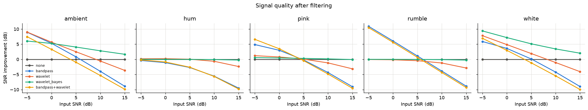
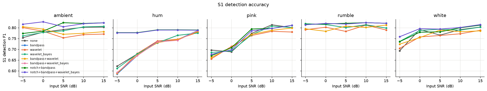

# Results

Development subset: the first 12 subjects of the CirCor training split with all four
auscultation sites, 44 annotated recordings (6.6–32.8 s, trimmed to 30 s),
median heart rate ≈ 115 bpm. Detection tolerance ±100 ms. Noise grid: 5 noise types ×
5 input SNRs (−5, 0, 5, 10, 15 dB) × 5 methods = 8800 trials. Regenerate with
`cardiofilter experiment --data data/circor/training_data --out results` followed by
`python scripts/write_results.py results docs/results.md README.md`.

## 1. Detection on the recordings as recorded

No synthetic noise; the recordings already contain the clinic's own noise.

| method | s1_precision | s1_recall | s1_f1 | s2_precision | s2_recall | s2_f1 | s1_mae_s |
| --- | --- | --- | --- | --- | --- | --- | --- |
| bandpass | 0.851 | 0.807 | 0.822 | 0.797 | 0.795 | 0.793 | 0.020 |
| bandpass+wavelet | 0.848 | 0.794 | 0.813 | 0.782 | 0.775 | 0.776 | 0.020 |
| bandpass+wavelet_bayes | 0.853 | 0.810 | 0.824 | 0.799 | 0.796 | 0.795 | 0.020 |
| none | 0.837 | 0.786 | 0.800 | 0.773 | 0.771 | 0.770 | 0.020 |
| notch+bandpass | 0.851 | 0.807 | 0.822 | 0.797 | 0.795 | 0.793 | 0.020 |
| notch+bandpass+wavelet_bayes | 0.853 | 0.810 | 0.824 | 0.799 | 0.796 | 0.795 | 0.020 |
| wavelet | 0.832 | 0.776 | 0.792 | 0.764 | 0.756 | 0.757 | 0.020 |
| wavelet_bayes | 0.837 | 0.786 | 0.801 | 0.772 | 0.771 | 0.770 | 0.020 |

**Reading it.** Bandpass before detection gives the best S1/S2 localisation
(S1 F1 0.82, S2 F1 0.79) with a mean timing error of 20 ms, well inside the 100 ms
tolerance. Wavelet thresholding on its own is slightly *worse* than no filtering: the
universal threshold shaves heart-sound energy from the 62–250 Hz bands along with the
noise. The remaining errors are dominated by S1/S2 label swaps in recordings where
systole and diastole have similar length (paediatric rates above ~120 bpm) and by
loud murmurs that create extra envelope peaks.

## 2. Controlled-noise experiment

### Averaged over every noise type and input SNR

| method | snr_improvement_db | prd_percent | correlation | s1_f1 | s2_f1 |
| --- | --- | --- | --- | --- | --- |
| bandpass | -0.84 | 67.93 | 0.75 | 0.77 | 0.76 |
| bandpass+wavelet | -1.32 | 70.31 | 0.72 | 0.76 | 0.74 |
| bandpass+wavelet_bayes | -0.86 | 67.86 | 0.75 | 0.78 | 0.76 |
| none | 0.00 | 76.69 | 0.80 | 0.77 | 0.75 |
| notch+bandpass | 0.04 | 59.14 | 0.79 | 0.79 | 0.77 |
| notch+bandpass+wavelet_bayes | 0.01 | 59.09 | 0.78 | 0.79 | 0.77 |
| wavelet | 0.52 | 64.70 | 0.81 | 0.75 | 0.73 |
| wavelet_bayes | 1.91 | 60.91 | 0.84 | 0.77 | 0.75 |

### By input SNR (averaged over noise types)

| snr_in_db | method | snr_improvement_db | s1_f1 | s2_f1 |
| --- | --- | --- | --- | --- |
| -5.00 | bandpass | 6.05 | 0.72 | 0.73 |
| -5.00 | bandpass+wavelet | 6.26 | 0.71 | 0.71 |
| -5.00 | bandpass+wavelet_bayes | 6.25 | 0.73 | 0.74 |
| -5.00 | none | 0.00 | 0.72 | 0.72 |
| -5.00 | notch+bandpass | 8.22 | 0.75 | 0.75 |
| -5.00 | notch+bandpass+wavelet_bayes | 8.42 | 0.77 | 0.76 |
| -5.00 | wavelet | 3.63 | 0.71 | 0.70 |
| -5.00 | wavelet_bayes | 3.20 | 0.72 | 0.72 |
| 0.00 | bandpass | 3.37 | 0.75 | 0.74 |
| 0.00 | bandpass+wavelet | 2.89 | 0.74 | 0.73 |
| 0.00 | bandpass+wavelet_bayes | 3.40 | 0.76 | 0.75 |
| 0.00 | none | 0.00 | 0.75 | 0.73 |
| 0.00 | notch+bandpass | 4.70 | 0.77 | 0.76 |
| 0.00 | notch+bandpass+wavelet_bayes | 4.71 | 0.78 | 0.77 |
| 0.00 | wavelet | 2.28 | 0.75 | 0.73 |
| 0.00 | wavelet_bayes | 2.58 | 0.75 | 0.73 |
| 10.00 | bandpass | -4.40 | 0.80 | 0.78 |
| 10.00 | bandpass+wavelet | -5.13 | 0.78 | 0.76 |
| 10.00 | bandpass+wavelet_bayes | -4.52 | 0.80 | 0.77 |
| 10.00 | none | 0.00 | 0.80 | 0.77 |
| 10.00 | notch+bandpass | -4.17 | 0.81 | 0.78 |
| 10.00 | notch+bandpass+wavelet_bayes | -4.30 | 0.81 | 0.78 |
| 10.00 | wavelet | -0.93 | 0.78 | 0.75 |
| 10.00 | wavelet_bayes | 1.25 | 0.80 | 0.77 |
| 15.00 | bandpass | -9.06 | 0.81 | 0.78 |
| 15.00 | bandpass+wavelet | -9.71 | 0.79 | 0.77 |
| 15.00 | bandpass+wavelet_bayes | -9.19 | 0.81 | 0.78 |
| 15.00 | none | 0.00 | 0.80 | 0.77 |
| 15.00 | notch+bandpass | -9.05 | 0.81 | 0.78 |
| 15.00 | notch+bandpass+wavelet_bayes | -9.18 | 0.81 | 0.78 |
| 15.00 | wavelet | -3.22 | 0.78 | 0.75 |
| 15.00 | wavelet_bayes | 0.63 | 0.80 | 0.76 |
| 5.00 | bandpass | -0.17 | 0.79 | 0.78 |
| 5.00 | bandpass+wavelet | -0.90 | 0.77 | 0.76 |
| 5.00 | bandpass+wavelet_bayes | -0.24 | 0.79 | 0.77 |
| 5.00 | none | 0.00 | 0.77 | 0.75 |
| 5.00 | notch+bandpass | 0.48 | 0.80 | 0.78 |
| 5.00 | notch+bandpass+wavelet_bayes | 0.41 | 0.80 | 0.77 |
| 5.00 | wavelet | 0.82 | 0.76 | 0.74 |
| 5.00 | wavelet_bayes | 1.89 | 0.78 | 0.75 |

### Hardest condition, input SNR −5 dB

| noise_type | method | snr_improvement_db | s1_f1 | s2_f1 |
| --- | --- | --- | --- | --- |
| ambient | bandpass | 8.95 | 0.77 | 0.78 |
| ambient | bandpass+wavelet | 7.47 | 0.80 | 0.77 |
| ambient | bandpass+wavelet_bayes | 8.13 | 0.82 | 0.81 |
| ambient | none | 0.00 | 0.75 | 0.73 |
| ambient | notch+bandpass | 8.95 | 0.77 | 0.78 |
| ambient | notch+bandpass+wavelet_bayes | 8.13 | 0.82 | 0.81 |
| ambient | wavelet | 9.01 | 0.80 | 0.77 |
| ambient | wavelet_bayes | 6.04 | 0.76 | 0.73 |
| hum | bandpass | -0.38 | 0.59 | 0.65 |
| hum | bandpass+wavelet | -0.20 | 0.59 | 0.63 |
| hum | bandpass+wavelet_bayes | -0.39 | 0.59 | 0.65 |
| hum | none | 0.00 | 0.62 | 0.67 |
| hum | notch+bandpass | 10.49 | 0.78 | 0.76 |
| hum | notch+bandpass+wavelet_bayes | 10.42 | 0.78 | 0.76 |
| hum | wavelet | 0.18 | 0.59 | 0.63 |
| hum | wavelet_bayes | -0.00 | 0.61 | 0.66 |
| pink | bandpass | 4.87 | 0.67 | 0.69 |
| pink | bandpass+wavelet | 6.61 | 0.66 | 0.67 |
| pink | bandpass+wavelet_bayes | 5.23 | 0.68 | 0.69 |
| pink | none | 0.00 | 0.70 | 0.69 |
| pink | notch+bandpass | 4.87 | 0.67 | 0.69 |
| pink | notch+bandpass+wavelet_bayes | 5.23 | 0.68 | 0.69 |
| pink | wavelet | 1.21 | 0.66 | 0.66 |
| pink | wavelet_bayes | 0.57 | 0.69 | 0.68 |
| rumble | bandpass | 10.90 | 0.82 | 0.79 |
| rumble | bandpass+wavelet | 10.47 | 0.79 | 0.76 |
| rumble | bandpass+wavelet_bayes | 10.82 | 0.81 | 0.78 |
| rumble | none | 0.00 | 0.82 | 0.79 |
| rumble | notch+bandpass | 10.90 | 0.82 | 0.79 |
| rumble | notch+bandpass+wavelet_bayes | 10.82 | 0.81 | 0.78 |
| rumble | wavelet | -0.05 | 0.79 | 0.76 |
| rumble | wavelet_bayes | -0.00 | 0.82 | 0.79 |
| white | bandpass | 5.89 | 0.74 | 0.73 |
| white | bandpass+wavelet | 6.95 | 0.72 | 0.72 |
| white | bandpass+wavelet_bayes | 7.48 | 0.76 | 0.74 |
| white | none | 0.00 | 0.69 | 0.70 |
| white | notch+bandpass | 5.89 | 0.74 | 0.73 |
| white | notch+bandpass+wavelet_bayes | 7.48 | 0.76 | 0.74 |
| white | wavelet | 7.81 | 0.70 | 0.70 |
| white | wavelet_bayes | 9.39 | 0.74 | 0.72 |

## 3. What the numbers say

1. **The right filter depends on the noise, which is why a single number misleads.**
   At −5 dB, bandpass is unbeatable against handling rumble (+10.9 dB; wavelets do
   nothing because 0–20 Hz sits in the approximation band they leave untouched) and
   as good as anything against ambient noise (+9.0 dB). Against broadband hiss,
   BayesShrink wavelets win on signal fidelity (+9.4 dB versus +5.9 dB for bandpass)
   because they remove noise *inside* the passband. Against pink noise, bandpass
   followed by wavelet thresholding is best (+6.6 dB).
2. **Mains hum needs its own stage.** 50 Hz and its harmonics sit in the middle of
   the S1/S2 band, produce large wavelet coefficients, and survive both bandpass and
   wavelet thresholding (≤ 0.2 dB); detection F1 falls to ~0.6 at −5 dB. A cascade of
   zero-phase IIR notches (Q = 30) at the fundamental and two harmonics recovers
   +10.5 dB and brings F1 back to 0.78/0.76, the same as a hum-free recording.
   The notch is gated on a tonal-power test so it is skipped when no hum is present;
   without that gate it carved enough heart-sound energy from clean recordings to cost
   3–4 F1 points.
3. **Bandpass can "lose" SNR at high input SNR.** The clean reference is the original
   recording, so removing genuine content outside 25–400 Hz counts as error: −9 dB at
   15 dB input. That is a property of the metric, not a reason to avoid the filter;
   detection F1, which is scored against human annotations, keeps improving with
   bandpass at every SNR. BayesShrink is the only single method that never reduces
   SNR, because its per-band thresholds back off when a band is mostly signal.
4. **Detection is less sensitive to filtering than SNR is.** The detector bandpasses
   internally, so even the `none` row benefits from a bandpass before envelope
   extraction. The extra filters matter most at −5 dB: +7 F1 points for white noise
   and +7 for ambient noise with `bandpass+wavelet_bayes`, +16 for hum with the notch.
5. **Combined methods need the noise level from the raw signal.** After a bandpass the
   finest wavelet band is empty, so a threshold estimated there collapses and the
   wavelet stage becomes a no-op. Estimating sigma on the raw signal fixes that. With
   the universal threshold the combination then over-smooths at high SNR (−9.7 dB at
   15 dB); with BayesShrink it does not, and `notch+bandpass+wavelet_bayes` has the
   best detection scores of every method both as recorded (S1 F1 0.824, S2 F1 0.795)
   and across the noise grid (0.79 / 0.77).

## 4. Recommendation for the prototype

- Default processing chain: **notch (when hum is detected) → bandpass 25–400 Hz →
  BayesShrink wavelet denoising with sigma from the raw signal**. This is the CLI
  default for `cardiofilter filter` and `cardiofilter visualize`.
- If only one stage can run (e.g. on a microcontroller): the bandpass. It is within
  a point of the full chain on detection and is the only stage that touches rumble.
- Hum should still be prevented in hardware (shielded cable, battery power); the
  notch takes a 1.7 Hz sliver out of the S1 band each time it fires.

## 5. Limitations

- The detector's five parameters were tuned on this same 44-recording subset, so the
  F1 values above are optimistic; section 6 reports the same metrics on subjects the
  detector never saw.
- Noise is synthetic and stationary. Real field noise is bursty (speech, footsteps),
  and the prototype's own recordings are the next validation step
  (`hardware/record.py`).
- Each SNR level is weighted equally in the averages; real recordings cluster at
  0–10 dB.

## 6. Held-out check

133 recordings from 40 subjects that were **not** used to tune the detector (`cardiofilter download --skip 12`). Same scoring.

### Detection as recorded (held-out)

| method | s1_precision | s1_recall | s1_f1 | s2_precision | s2_recall | s2_f1 | s1_mae_s |
| --- | --- | --- | --- | --- | --- | --- | --- |
| bandpass | 0.791 | 0.774 | 0.776 | 0.760 | 0.755 | 0.753 | 0.025 |
| bandpass+wavelet | 0.802 | 0.762 | 0.773 | 0.759 | 0.742 | 0.744 | 0.025 |
| bandpass+wavelet_bayes | 0.791 | 0.773 | 0.776 | 0.761 | 0.756 | 0.754 | 0.025 |
| none | 0.790 | 0.765 | 0.770 | 0.764 | 0.753 | 0.752 | 0.025 |
| notch+bandpass | 0.791 | 0.774 | 0.776 | 0.760 | 0.755 | 0.753 | 0.025 |
| notch+bandpass+wavelet_bayes | 0.791 | 0.773 | 0.776 | 0.761 | 0.756 | 0.754 | 0.025 |
| wavelet | 0.794 | 0.752 | 0.763 | 0.754 | 0.734 | 0.738 | 0.025 |
| wavelet_bayes | 0.792 | 0.768 | 0.773 | 0.767 | 0.755 | 0.755 | 0.025 |

**Generalisation gap.** With the bandpass, S1/S2 F1 falls from 0.822/0.793 on the tuning subset to 0.776/0.753 here, so quote the held-out numbers. The recommended chain `notch+bandpass+wavelet_bayes` scores 0.776/0.754 as recorded; the ranking of methods is unchanged, and the notch again restores hum-corrupted recordings to clean-recording accuracy.

### Noise grid (held-out), input SNR -5, 5 dB

| method | snr_improvement_db | prd_percent | correlation | s1_f1 | s2_f1 |
| --- | --- | --- | --- | --- | --- |
| bandpass | 2.89 | 80.31 | 0.69 | 0.69 | 0.68 |
| bandpass+wavelet | 2.61 | 81.01 | 0.65 | 0.69 | 0.65 |
| bandpass+wavelet_bayes | 2.98 | 79.32 | 0.68 | 0.71 | 0.68 |
| none | 0.00 | 117.03 | 0.68 | 0.69 | 0.67 |
| notch+bandpass | 4.31 | 64.94 | 0.75 | 0.72 | 0.71 |
| notch+bandpass+wavelet_bayes | 4.39 | 63.97 | 0.74 | 0.74 | 0.71 |
| wavelet | 2.16 | 91.03 | 0.71 | 0.69 | 0.65 |
| wavelet_bayes | 2.52 | 90.82 | 0.74 | 0.70 | 0.68 |

### Held-out, hardest condition (input SNR -5 dB)

| noise_type | method | snr_improvement_db | s1_f1 | s2_f1 |
| --- | --- | --- | --- | --- |
| ambient | bandpass | 8.88 | 0.73 | 0.72 |
| ambient | bandpass+wavelet | 7.27 | 0.75 | 0.67 |
| ambient | bandpass+wavelet_bayes | 8.03 | 0.77 | 0.71 |
| ambient | none | 0.00 | 0.69 | 0.67 |
| ambient | notch+bandpass | 8.88 | 0.73 | 0.72 |
| ambient | notch+bandpass+wavelet_bayes | 8.03 | 0.77 | 0.71 |
| ambient | wavelet | 8.73 | 0.75 | 0.67 |
| ambient | wavelet_bayes | 5.86 | 0.72 | 0.68 |
| hum | bandpass | -0.40 | 0.56 | 0.52 |
| hum | bandpass+wavelet | -0.27 | 0.57 | 0.53 |
| hum | bandpass+wavelet_bayes | -0.40 | 0.56 | 0.52 |
| hum | none | 0.00 | 0.57 | 0.54 |
| hum | notch+bandpass | 10.49 | 0.78 | 0.75 |
| hum | notch+bandpass+wavelet_bayes | 10.46 | 0.78 | 0.75 |
| hum | wavelet | 0.13 | 0.57 | 0.54 |
| hum | wavelet_bayes | 0.00 | 0.56 | 0.54 |
| pink | bandpass | 4.88 | 0.54 | 0.56 |
| pink | bandpass+wavelet | 6.55 | 0.54 | 0.53 |
| pink | bandpass+wavelet_bayes | 5.24 | 0.56 | 0.57 |
| pink | none | 0.00 | 0.53 | 0.54 |
| pink | notch+bandpass | 4.88 | 0.54 | 0.56 |
| pink | notch+bandpass+wavelet_bayes | 5.24 | 0.56 | 0.57 |
| pink | wavelet | 1.16 | 0.52 | 0.52 |
| pink | wavelet_bayes | 0.56 | 0.53 | 0.56 |
| rumble | bandpass | 10.87 | 0.77 | 0.76 |
| rumble | bandpass+wavelet | 10.61 | 0.77 | 0.75 |
| rumble | bandpass+wavelet_bayes | 10.83 | 0.78 | 0.76 |
| rumble | none | 0.00 | 0.78 | 0.75 |
| rumble | notch+bandpass | 10.87 | 0.77 | 0.76 |
| rumble | notch+bandpass+wavelet_bayes | 10.83 | 0.78 | 0.76 |
| rumble | wavelet | -0.03 | 0.77 | 0.75 |
| rumble | wavelet_bayes | -0.00 | 0.78 | 0.75 |
| white | bandpass | 5.83 | 0.57 | 0.57 |
| white | bandpass+wavelet | 6.77 | 0.60 | 0.59 |
| white | bandpass+wavelet_bayes | 7.51 | 0.64 | 0.62 |
| white | none | 0.00 | 0.56 | 0.58 |
| white | notch+bandpass | 5.83 | 0.57 | 0.57 |
| white | notch+bandpass+wavelet_bayes | 7.51 | 0.64 | 0.62 |
| white | wavelet | 7.57 | 0.59 | 0.58 |
| white | wavelet_bayes | 9.32 | 0.62 | 0.61 |
